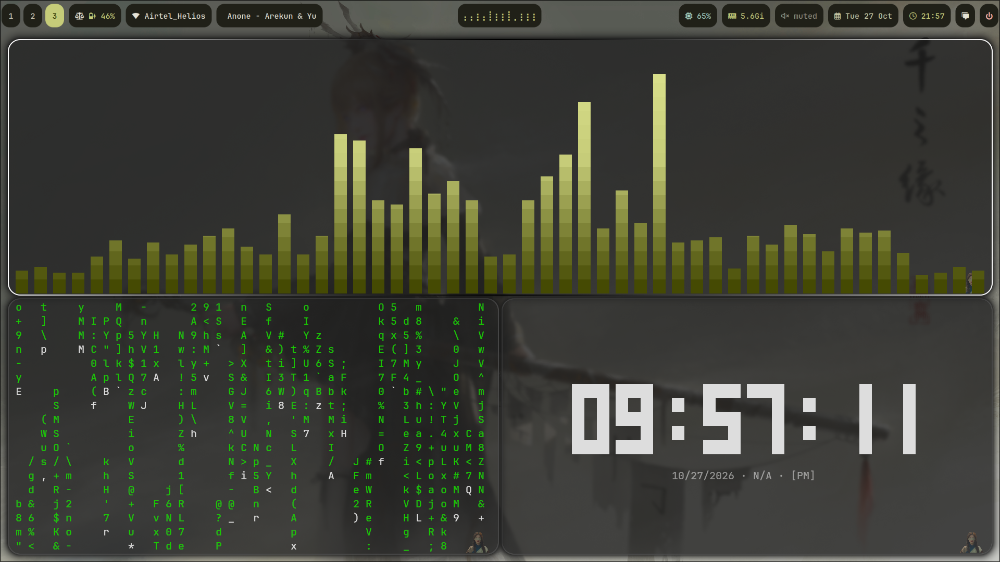
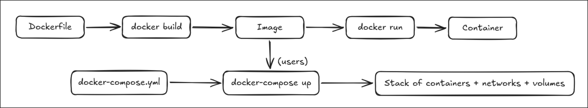
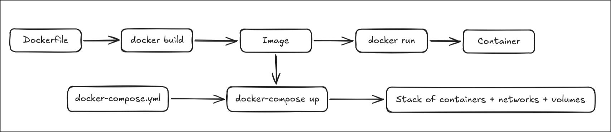

# 🎨 Dotfiles — Hyprland + Waybar + Rofi + more

<p align="center">
  
</p>

<p align="center">
  <a href="https://hyprland.org"></a>
  <a href="https://github.com/Alexays/Waybar"></a>
  <a href="https://github.com/davatorium/rofi"></a>
  <a href="https://github.com/kovidgoyal/kitty"></a>
</p>

A curated collection of configuration files for a custom Linux desktop
based on **Hyprland** (Wayland compositor), **Waybar** (status bar),
**Rofi** (launcher), and a full suite of quality-of-life tools.

Built with a **Material You** color scheme via `matugen`, Amanojaku
palette, and a retro-cyber theme for the music player.

---

## 📸 Gallery

### Desktop

<p align="center">
  
</p>

### Terminal (Kitty)

<p align="center">
  
</p>

### Rofi Launcher

<p align="center">
  
</p>

---

## ✨ Features

- **Hyprland** — window manager with blur, rounded corners, animations
- **Waybar** — modular status bar with Cava audio visualizer integration
- **Rofi** — app launcher, power menu, wallpaper switcher
- **Kitty** — GPU-accelerated terminal with themes
- **Fish + Starship** — smart shell with a beautiful prompt
- **Matugen** — Material You dynamic theming
- **SwayNC** — notification center with custom styling
- **rmpc** — music player with retro-cyber theme
- **Btop** — resource monitor with custom themes
- **Fastfetch** — system info with ASCII art

---

## 📁 Components

| Directory | Tool | What's here |
|---|---|---|
| `hypr/` | Hyprland | Compositor config, binds, decorations, lock screen, idle |
| `waybar/` | Waybar | Bar config, style, Cava integration, control scripts |
| `rofi/` | Rofi | Launcher config, power menu, wallpaper switcher |
| `kitty/` | Kitty | Terminal config + themes |
| `fish/` | Fish shell | Config, functions, completions, conf.d drop-ins |
| `starship.toml` | Starship | Cross-shell prompt config |
| `swaync/` | SwayNC | Notification UI + style |
| `cava/` | Cava | Audio visualizer config (feeds Waybar) |
| `btop/` | Btop | Resource monitor config + themes |
| `fastfetch/` | Fastfetch | System info output + ASCII logos |
| `colorscheme/` | — | Amanojaku color palette (CSS/JSON/Lua/TOML) |
| `matugen/` | Matugen | Material You color generator config |
| `rmpc/` | rmpc | Music player client config + retro-cyber theme |
| `wallpapers/` | — | Curated wallpaper collection |
| `cmus/lib.pl` | CMUS | Music player Lisp config |
| `screenshots/` | — | Desktop screenshots for reference |

---

## 🚀 Quick start

```bash
# Clone
git clone --recursive https://github.com/Safaizal/dotfiles.git
cd dotfiles

# Symlink what you want
ln -sf ~/dotfiles/hypr ~/.config/hypr
ln -sf ~/dotfiles/waybar ~/.config/waybar
ln -sf ~/dotfiles/rofi ~/.config/rofi
# ... repeat for each tool you want
```

---

## 📦 Dependencies

```bash
hyprland  waybar  rofi-wayland  fish  starship  kitty
swaync  cava  btop  fastfetch  matugen  rmpc
```

---

## 📝 License

Feel free to use and modify. Credit appreciated but not required.
